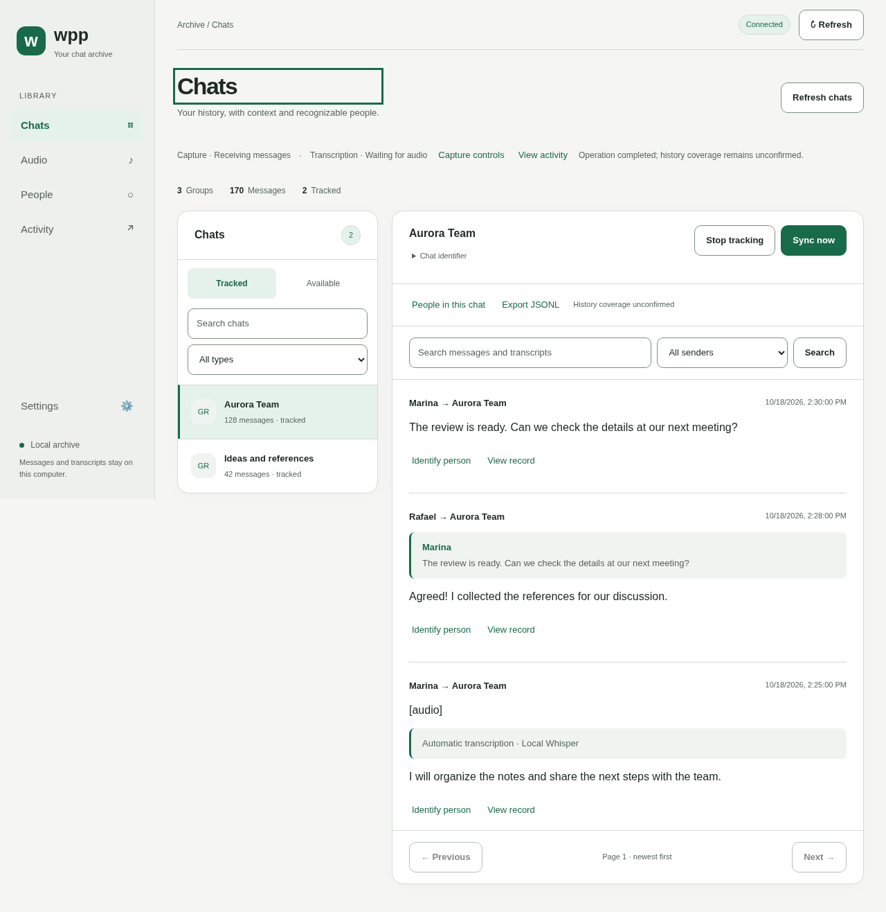

# wpp · Your local chat archive

[](https://github.com/flaviomilan/wpp/actions/workflows/quality.yml)
[](go.mod)
[](docs/operation.md#installation-and-first-use)
[](#application-language)
[](LICENSE)

Capture selected WhatsApp chats, read their history, and transcribe audio locally. **wpp** combines a **CLI that runs without a browser** and an **intuitive web workspace** in one Go executable. SQLite stores messages and the session; JSONL supports complete export and incremental consumption by other systems.



## Start in your browser

Build requirements: **Go 1.26+**, toolchain **1.26.9**, a C compiler (`gcc` or equivalent), and CGO enabled. Operational support targets **Linux and macOS**; Windows is unsupported. Node.js/npm are used only for development checks.

```bash
make build
# Without make: go build -buildvcs=false -trimpath -o wpp ./cmd/wpp
./wpp serve
# Open http://127.0.0.1:8080
```

In **Settings > Account**, connect WhatsApp using your phone's QR scanner. Return to **Chats**, choose **Refresh chats**, and track the conversations you want. Enable continuous capture under **Settings > Capture**, or use **Sync now** in a chat.

Closing the tab keeps the process active; Ctrl+C stops it. A new installation starts with capture paused and remembers preferences. The panel follows the system theme and supports narrow screens and keyboard navigation.

## Application language

English is the default. Choose **English** or **Português (Brasil)** under **Settings > Advanced > Application language**, then **Save language**. The saved choice is shared by web and CLI in the same data directory and survives restarts. Browser and terminal locales do not select it automatically.

```bash
./wpp language pt-BR       # Remember Brazilian Portuguese
./wpp language en          # Remember English
./wpp --language en status # Override this invocation only
```

Application language is independent of audio recognition language and time zone. Messages, names, transcripts, and exported data retain their original content. Documentation is maintained in English. See [language behavior and overrides](docs/operation.md#application-language).

## Start with the CLI

```bash
./wpp login
./wpp chats
./wpp track 'FULL_ID_SHOWN'
./wpp run
```

Copy the full ID from `chats`; names are not identifiers. `run` captures in the foreground without starting HTTP. For background execution, see [external supervision and the systemd example](docs/operation.md#background-capture-on-linux).

```bash
./wpp status
./wpp export
```

Global options come **before** the command. Relative directories start at the working directory:

```bash
./wpp --data-dir ./data --export-dir ./exports --timezone America/Sao_Paulo run
```

Reuse matching directories on restart. One process owns capture per archive: with `run` active, `serve` opens in consultation mode and explains the conflict. Stop the owner and restart `serve` to take control. Never delete the lock.

## Audio and data

Transcription is optional and uses local Whisper/FFmpeg; no language-model API call is required. Install an engine/model using [the transcription guide](docs/transcription.md), configure **Settings > Transcription**, and inspect the queue in **Audio**. Sound files are temporary; text persists. Text capture works without an audio engine. Audio recognition defaults to Portuguese independently of the English interface.

SQLite is the primary source. Complete exports live in `exports/chat-<hash>.jsonl`; incremental batches have a manifest and independent cursor. Data and export directories contain private content and must never be sent to GitHub.

```bash
./wpp events next '123456789@g.us'
# Persist events with uniqueness on event_id before acknowledgement.
./wpp events ack '123456789@g.us' E000001
./wpp events status '123456789@g.us'
```

Identifiers above are fictitious. See the [JSONL contract](docs/jsonl-events.md) for schemas, reactions, edits, and transcripts. Complete export does not acknowledge batches. `batch` aliases the `events` protocol.

## Important limits

WhatsApp integration is **unofficial**, using [whatsmeow](https://github.com/tulir/whatsmeow), and can break or lead to account restrictions. wpp does not send messages to contacts or mark messages read; it makes protocol requests needed for synchronization.

**Complete history and absence of gaps are never certified.** The application preserves what it receives and attempts to retrieve what the phone makes available. Operational success does not establish coverage. Deleted, expired, or unavailable messages may be unrecoverable.

The panel accepts loopback connections only and does not provide authenticated remote access. One data directory belongs to one account. This version does not provide multiple accounts per directory, manual export imports, channels/status, or downloads of media other than audio.

## Documentation

- [Web workspace and settings](docs/interface.md)
- [Installation, commands, backup, and background operation](docs/operation.md)
- [Capture behavior and guarantees](docs/how-it-works.md)
- [Local transcription](docs/transcription.md)
- [Incremental consumption by AI and external systems](docs/ai-consumption.md)
- [JSONL event contract](docs/jsonl-events.md)
- [Architecture](docs/architecture.md) and [quality](docs/quality.md)
- [Contributing](CONTRIBUTING.md), [security](SECURITY.md), and [code of conduct](CODE_OF_CONDUCT.md)
- [Public launch preparation](docs/release.md)

## Development

Go/C and Node.js 24+ are needed for checks. Distribution builds use Go/C only and embed the web assets.

```bash
make tools
make check
make build
npx playwright install chromium
npm run test:browser
```

Standard tests use temporary/synthetic data without a WhatsApp session. Real pairing needs the account holder's action and is not required to contribute. README images are synthetic browser-test demonstrations.

`make tools` also installs local publication hooks. Use your GitHub `noreply` address in commits and stage only reviewed public files from the manifest. Commits, pushes, and packages undergo content validation and secret scanning; new files and images require explicit review. See [Contributing](CONTRIBUTING.md) and the protection limits in [Security](SECURITY.md).

## Authorship and license

Created and maintained by [Flávio Milan (@flaviomilan)](https://github.com/flaviomilan), targeting [flaviomilan/wpp](https://github.com/flaviomilan/wpp).

First-party code uses the [MIT license](LICENSE), allowing use, modification, and redistribution, including commercial use, while retaining the copyright notice and license text in copies or substantial portions. Attribution does not require a credit in each derivative application's interface.

Dependencies retain their licenses. In particular, an executable incorporating libsignal must meet GPL v3 requirements; the first-party MIT license does not make that combined binary MIT-only. See [third-party notices](THIRD_PARTY_NOTICES.md) and the [release checklist](docs/release.md).

Use [Issues](https://github.com/flaviomilan/wpp/issues) for usage problems and proposals. Security reports follow [SECURITY.md](SECURITY.md) without publishing personal contact details. Preparation does not automatically create/publish the repository or releases.
