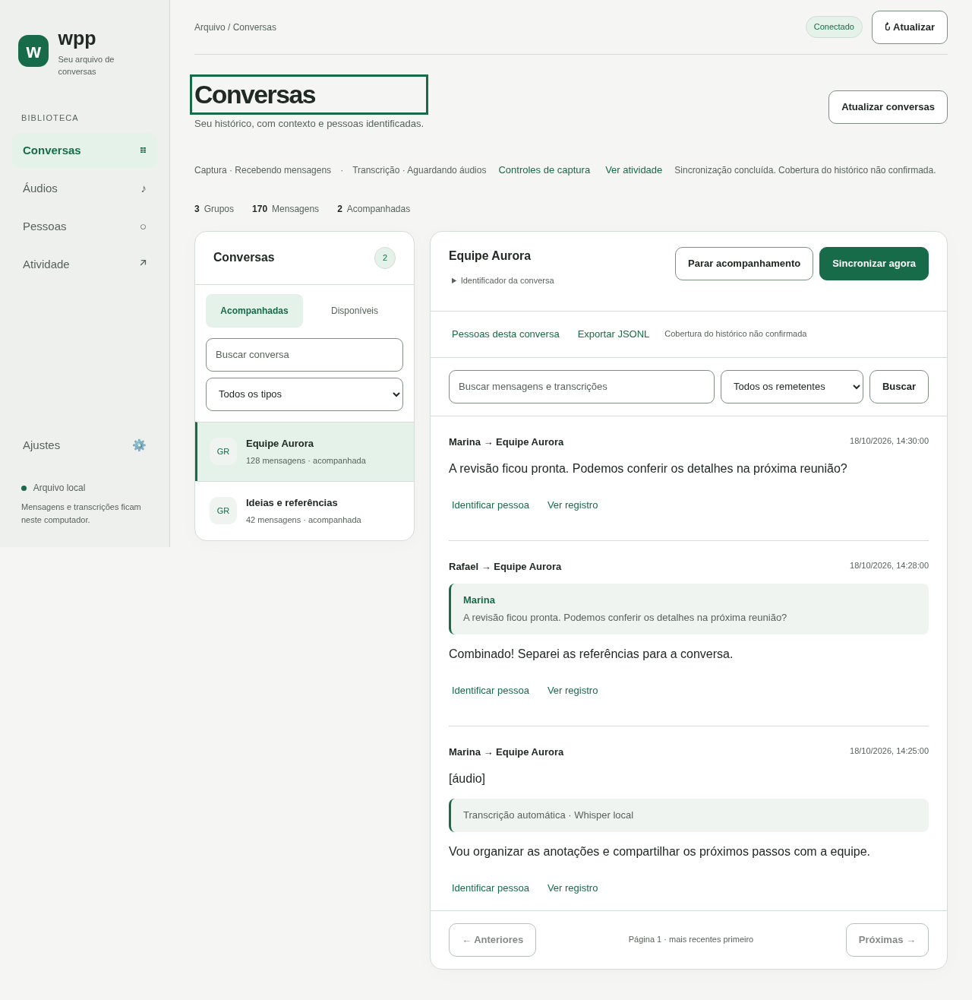

# wpp · Seu arquivo local de conversas

Capture conversas selecionadas do WhatsApp, leia seu histórico e transcreva áudios localmente. O **wpp** reúne uma **CLI que funciona sem navegador** e um **painel web intuitivo**, no mesmo executável Go. SQLite guarda mensagens e sessão; JSONL permite exportação completa e consumo incremental por outros sistemas.



## Começar pelo navegador

Requisitos de compilação: **Go 1.26+**, toolchain **1.26.9**, compilador C (`gcc` ou equivalente) e CGO habilitado. Suporte operacional a **Linux e macOS**; Windows não é suportado. Node.js/npm são usados apenas nas verificações de desenvolvimento.

```bash
make build
# Sem make: go build -buildvcs=false -trimpath -o wpp ./cmd/wpp
./wpp serve
# Abra http://127.0.0.1:8080
```

Em **Ajustes → Conta**, conecte o WhatsApp pelo QR do celular. Volte a **Conversas**, use **Atualizar conversas** e acompanhe as desejadas. Em **Ajustes → Captura**, ative a captura contínua, ou use **Sincronizar agora** em uma conversa.

Fechar a aba mantém o processo ativo; Ctrl+C encerra. A primeira abertura começa com captura pausada. As preferências ficam persistidas. O painel acompanha o tema do sistema e funciona em telas estreitas e com teclado.

## Começar pela CLI

```bash
./wpp login
./wpp chats
./wpp track 'ID_COMPLETO_EXIBIDO'
./wpp run
```

Copie o ID completo de `chats`; nomes não são identificadores. `run` captura em primeiro plano sem abrir HTTP. Para execução em background, use o [guia de supervisão externa e exemplo systemd](docs/operacao.md#captura-em-background-no-linux).

```bash
./wpp status
./wpp export
```

Opções globais vêm **antes** do comando. Diretórios relativos partem do diretório de execução:

```bash
./wpp --data-dir ./dados --export-dir ./exports --timezone America/Sao_Paulo run
```

Use os mesmos diretórios ao reiniciar. Um único processo controla cada arquivo: com `run` ativo, `serve` abre em consulta e explica o conflito. Para assumir controle pelo navegador, pare o proprietário e reinicie `serve`. Não apague o lock.

## Áudio e dados

A transcrição é opcional e usa Whisper/FFmpeg locais; nenhuma chamada a um modelo de linguagem é necessária. Instale o motor/modelo pelo [guia de transcrição](docs/transcricao.md), configure **Ajustes → Transcrição** e consulte a fila em **Áudios**. Os arquivos sonoros são temporários; o texto é persistido. A captura de texto funciona sem motor de áudio.

SQLite é a fonte principal. Exports completos ficam em `exports/chat-<hash>.jsonl`; lotes incrementais têm manifesto e cursor independente. Os diretórios de dados e exports contêm conteúdo privado e não devem ser enviados ao GitHub.

```bash
./wpp events next '123456789@g.us'
# Persista os eventos com unicidade por event_id antes de confirmar.
./wpp events ack '123456789@g.us' E000001
./wpp events status '123456789@g.us'
```

Os identificadores acima são fictícios. Consulte o [contrato JSONL](docs/eventos-jsonl.md) para schemas, reações, edições e transcrições. A exportação completa não confirma lotes. O alias `batch` compartilha o protocolo de `events`.

## Limites importantes

A integração com WhatsApp é **não oficial**, baseada em [whatsmeow](https://github.com/tulir/whatsmeow), e pode quebrar ou resultar em restrição da conta. O wpp não envia mensagens a contatos nem confirma leitura; faz as solicitações de protocolo necessárias à sincronização.

**Histórico integral e ausência de lacunas nunca são certificados.** O programa preserva o que recebe e tenta recuperar o que o celular disponibiliza. Resultado operacional bem-sucedido não comprova cobertura. Mensagens apagadas, expiradas ou indisponíveis podem não ser recuperáveis.

O painel aceita somente loopback; não é um serviço remoto autenticado. Um diretório de dados é vinculado a uma única conta. Não há múltiplas contas no mesmo diretório, importação manual de exports, canais/status ou download de outras mídias nesta versão.

## Documentação

- [Interface web e ajustes](docs/interface.md)
- [Instalação, comandos, backup e operação em background](docs/operacao.md)
- [Funcionamento e garantias da captura](docs/funcionamento.md)
- [Transcrição local](docs/transcricao.md)
- [Consumo incremental por IA e sistemas externos](docs/consumo-ia.md)
- [Contrato dos eventos JSONL](docs/eventos-jsonl.md)
- [Arquitetura](docs/arquitetura.md) e [qualidade](docs/qualidade.md)
- [Contribuição](CONTRIBUTING.md), [segurança](SECURITY.md) e [convivência](CODE_OF_CONDUCT.md)
- [Preparação do lançamento público](docs/lancamento.md)

## Desenvolvimento

Go/C e Node.js 24+ são necessários para os checks. O build de distribuição usa apenas Go/C e inclui os assets web.

```bash
make tools
make check
make build
npx playwright install chromium
npm run test:browser
```

Todos os testes padrão usam dados temporários/fictícios e dispensam sessão WhatsApp. Pareamento real precisa da ação do titular e não é requisito de contribuição. As imagens deste README são demonstrações fictícias geradas pelos testes do navegador.

`make tools` também instala os hooks locais de publicação. Use seu endereço GitHub `noreply` nos commits e prepare apenas arquivos públicos revisados no manifesto. Commits, pushes e pacotes passam por validação de conteúdo e scanner de segredos; novos arquivos e imagens exigem revisão explícita. Veja [Contribuição](CONTRIBUTING.md) e os limites dessas proteções em [Segurança](SECURITY.md).

## Autoria e licença

Criado e mantido por [Flávio Milan (@flaviomilan)](https://github.com/flaviomilan), com repositório de destino [flaviomilan/wpp](https://github.com/flaviomilan/wpp).

O código próprio é distribuído sob a [licença MIT](LICENSE): permite uso, alteração e redistribuição, inclusive comercial, preservando o aviso de copyright e o texto da licença nas cópias ou partes substanciais. A atribuição não exige um crédito na interface de cada aplicação derivada.

As dependências mantêm suas licenças. Em particular, o executável que incorpora libsignal precisa observar a GPL v3; a licença MIT do código próprio não transforma esse conjunto em um binário exclusivamente MIT. Veja [avisos de terceiros](THIRD_PARTY_NOTICES.md) e o [checklist de lançamento](docs/lancamento.md).

Problemas de uso e propostas vão para [Issues](https://github.com/flaviomilan/wpp/issues). Relatos de segurança seguem [SECURITY.md](SECURITY.md); não exigem divulgar contato pessoal. Esta preparação não cria nem publica automaticamente o repositório ou releases.
