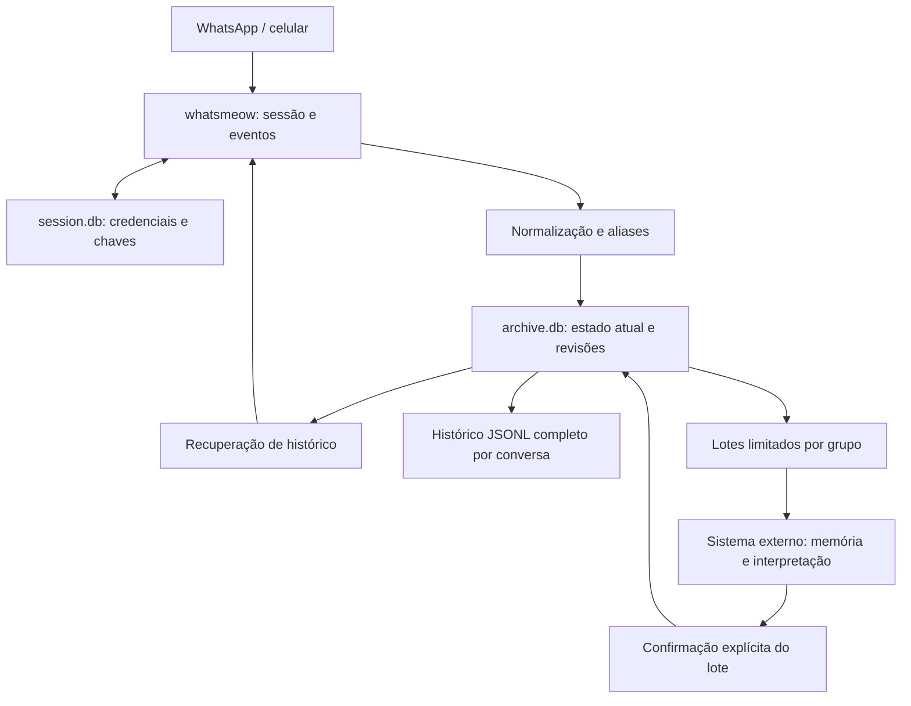
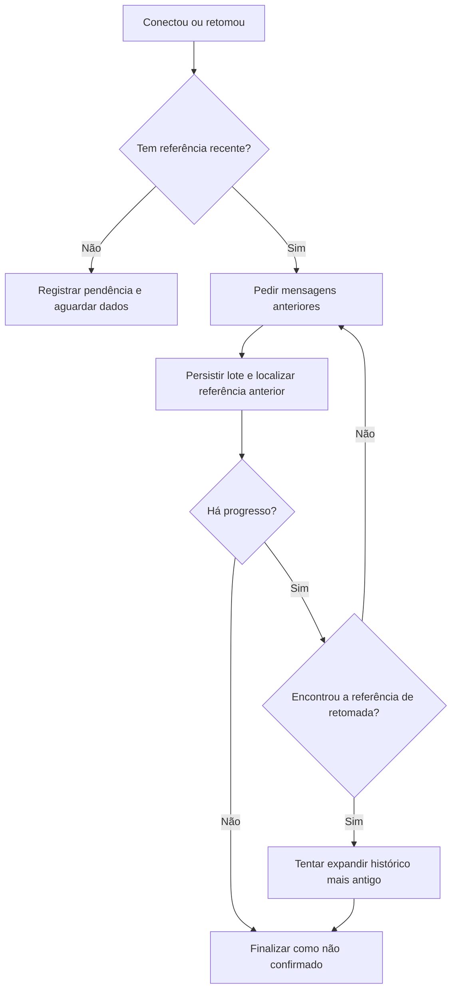

# Funcionamento do wpp

Este guia descreve o comportamento implementado no projeto. Para executar e administrar a aplicação, consulte [Operação e comandos](operacao.md). Para acompanhar demandas com um agente externo, consulte [Consumo por IA](consumo-ia.md).

## 1. O que a aplicação faz

O wpp vincula uma conta do WhatsApp como dispositivo conectado, recebe mensagens de grupos e conversas selecionados, persiste o conteúdo normalizado em SQLite e exporta eventos JSONL. Também prepara lotes limitados para que um agente externo acompanhe demandas discutidas nos grupos.

É um executável de terminal. O comando `run` permanece em primeiro plano enquanto captura mensagens. A aplicação não instala um serviço do sistema. O comando `serve` mantém o painel HTTP local e controla captura, histórico, transcrição e exportação. Compartilha `internal/service` com `run`. Outro controlador no diretório faz o painel abrir em consulta. Os outros comandos executam uma ação e terminam.

A integração usa Go, whatsmeow e SQLite, sem navegador e sem a API oficial do WhatsApp. A IA não está integrada ao executável: interpretar mensagens, associar demandas e atualizar sua memória são responsabilidades do consumidor dos arquivos.

## 2. Arquitetura

| Área | Responsabilidade | Local no código |
|---|---|---|
| CLI | Opções, comandos e sinais | `cmd/wpp` |
| Integração | Login, conexão, eventos, consulta de grupos e solicitação de histórico | `internal/whatsapp` |
| Arquivo | Mensagens, aliases, tentativas de recuperação, revisões, JSONL e lotes | `internal/archive` |
| Coordenação | Operações, conexão, histórico, áudio, exportação e encerramento | `internal/service` |
| Transcrição | Reserva de tarefa, mídia temporária e motor local | `internal/transcription` |
| Painel | HTTP local protegido e módulos JavaScript por área | `internal/webui` |

A normalização produz um modelo independente do transporte. O armazenamento e a renderização não precisam interpretar diretamente todas as estruturas protobuf do WhatsApp.

## 3. Autenticação e descoberta

`login` abre a sessão local. Quando ainda não há dispositivo vinculado, exibe um QR code. O titular lê esse código no celular em **WhatsApp → Dispositivos conectados → Conectar dispositivo**. Após o pareamento, o comando espera a conexão e aguarda dez segundos para a sincronização inicial antes de tentar descobrir grupos e contatos.

As credenciais e chaves são persistidas em `session.db` pelo `sqlstore` do whatsmeow. Reiniciar a aplicação normalmente reutiliza essa sessão. Um login já existente faz `login` informar que a sessão está vinculada; esse caminho não constitui uma verificação remota de que a sessão ainda está válida.

O arquivo local é associado à primeira conta autenticada. Uma conta diferente não pode reutilizar o mesmo diretório de dados. Os handlers são registrados antes da conexão.

`chats` consulta grupos participantes e contatos disponíveis. Se um grupo vier sem nome, tenta consultar seus detalhes individualmente, com timeout de dez segundos. O histórico também pode fornecer nomes pelos campos de nome ou nome de exibição. Um nome vazio recebido depois não apaga um nome já conhecido.

Os sufixos dos identificadores distinguem:

| Sufixo | Significado |
|---|---|
| `@g.us` | Grupo |
| `@s.whatsapp.net` | Identidade baseada no número de telefone |
| `@lid` | Identidade alternativa de usuário disponibilizada pelo WhatsApp |

Nomes são rótulos mutáveis. O acompanhamento usa o identificador completo.

## 4. Seleção e ingestão

`track` habilita uma conversa persistentemente; `untrack` desabilita novas incorporações ao seu arquivo e preserva o conteúdo já armazenado.

A descoberta e os eventos podem apresentar conversas não acompanhadas. Para elas, o banco guarda metadados e um envelope recente como referência para um primeiro scan. Isso inclui o conteúdo normalizado dessa referência; não equivale a arquivar todo o histórico da conversa.

Ao habilitar uma conversa, a referência recente disponível é incorporada ao arquivo. O comando de acompanhamento aceita um ID válido ainda não descoberto; nesse caso, a conversa pode permanecer sem nome, referência ou mensagens até receber dados.

Durante a captura, mensagens ao vivo e lotes de histórico seguem o mesmo fluxo:

1. Resolver aliases de remetentes e destinatários quando houver mapeamento.
2. Retirar envelopes como mensagem efêmera, documento com legenda ou edição.
3. Normalizar identificação, autoria, data, conteúdo e referências.
4. Atualizar a referência recente da conversa.
5. Para conversas acompanhadas, mesclar com a mensagem existente e registrar a mudança.
6. Concluir a transação antes de considerar a persistência bem-sucedida.

As confirmações de protocolo são configuradas para aguardar o retorno dos handlers. Isso reduz o risco de confirmar recebimento antes da gravação local. Não é uma confirmação de leitura ao contato nem uma garantia de que o WhatsApp entregará todo o histórico.

### Deduplicação e ordem

A chave local inclui conversa, ID da mensagem, direção e, em grupos, remetente. Em conversas individuais, o remetente não é parte adicional da chave SQL.

Mensagens repetidas passam pela mesclagem. Se o estado resultante não mudou, não produzem uma nova revisão. Uma mensagem antiga recebida depois é incorporada normalmente: a última data conhecida não é usada como filtro de descarte.

Aliases LID/número podem unificar chaves que antes pareciam diferentes. A reconciliação é transacional, preserva fontes existentes e mantém redirecionamentos quando fontes duplicadas são unificadas.

### Conteúdo tratado

| Conteúdo | Representação |
|---|---|
| Texto | Texto e quebras de linha |
| Resposta | ID citado e remetente citado quando disponível |
| Reação | Emoji ou marcador de remoção, com referência à mensagem reagida; texto original preservado |
| Imagem ou vídeo | Tipo, legenda e contexto da resposta |
| Áudio | Tipo, referência e transcrição automática quando o worker concluir |
| Documento | Tipo, nome do arquivo, legenda e contexto |
| Figurinha | Identificação do tipo |
| Localização | Nome, endereço e coordenadas disponíveis |
| Cartão de contato | Nome de exibição disponível |
| Evento de sistema do histórico | Placeholder com tipo do evento |
| Conteúdo não decriptado | Placeholder `indisponível` |
| Tipo não interpretado | Placeholder do tipo; sem interpretação semântica |

Áudios elegíveis são baixados temporariamente para transcrição e removidos após o processamento; outras mídias não são baixadas. Retirar um envelope não recupera conteúdo que não foi entregue ou não pôde ser decriptado. Mensagens de controle do protocolo que não representam edição ou exclusão não são arquivadas como texto da conversa.

### Edições e exclusões

A edição atualiza o estado atual da mensagem; a exclusão passa a ser representada por um marcador. Uma atualização recebida antes do original pode ser guardada com a data original desconhecida e reconciliada quando o original chegar.

O merge preserva exclusões e edições contra reenvios antigos. Reações possuem sua própria chave e não são aplicadas como edição da mensagem reagida. O painel mostra autor e prévia do original quando a referência tem correspondência única no arquivo. Reações criptografadas não disponíveis ficam sinalizadas, mantendo a referência quando recebida. Placeholders de tipos antes não interpretados são atualizados quando o conteúdo reconhecido é entregue novamente; isso gera uma revisão de recuperação. Na abertura do banco, placeholders antigos de reações recebem o tipo correto e a indicação de conteúdo indisponível, em transação, preservando fonte e revisões. Essa atualização não inventa o emoji nem a referência descartados por versões anteriores. Eles podem ser restaurados se o WhatsApp entregar o evento novamente. Um placeholder indisponível pode ser substituído pelo conteúdo recuperado. As revisões já registradas e os lotes já publicados permanecem no arquivo histórico: excluir no WhatsApp não remove todas as cópias locais anteriores.

## 5. Recuperação após uma parada

Ao iniciar `run`, a aplicação recupera referências persistidas de retomada e registra tentativas anteriores interrompidas. Depois de conectar, tenta recuperar as conversas acompanhadas, uma por vez. Entregas pendentes passam pelo mesmo fluxo de ingestão; conversas são descobertas pela ação dedicada do painel ou pelos comandos de login/descoberta.

As solicitações pedem até 50 mensagens **anteriores** a uma referência, com timeout de 45 segundos. As respostas são correlacionadas pelo identificador da solicitação. Há uma pausa de um segundo entre páginas.

Quando não há referência mais recente que o checkpoint, o pedido não consegue demonstrar que preencheu o período offline. A aplicação pode estender o histórico a partir da mensagem mais antiga, mantendo a incerteza sobre a retomada.

Cada tentativa registra início, fim, âncora, detalhe e observação de sobreposição. Estados persistidos incluem `running` e `unconfirmed`. Observar uma âncora resolve a necessidade de insistir até aquela referência, mas não transforma a tentativa em certificação de completude. Âncoras não alcançadas são preservadas para novas tentativas.

Há novas tentativas a cada cinco minutos enquanto conectado. A chegada de uma primeira referência em conversa antes sem referência pode disparar outra tentativa. Uma desconexão cancela o scan atual; a biblioteca cuida da reconexão com esperas crescentes.

**O programa nunca certifica que recebeu todas as mensagens nem que não existem lacunas.** Ausência de novas mensagens, lote vazio, timeout ou sobreposição não provam histórico completo.

## 6. Exportação exclusiva em JSONL

O exportador gera `exports/chat-<hash>.jsonl` com os eventos imutáveis observados da conversa, em sequência local. Não é uma projeção só do estado atual: edições, exclusões, transcrições e reações permanecem eventos distintos.

A escrita usa uma transação WAL separada, somente leitura, arquivo temporário, sincronização e renomeação. A geração exportada é marcada depois da publicação; eventos recebidos durante a leitura continuam pendentes. Uma falha do arquivo não desfaz a ingestão.

`events next|ack|status` fornece lotes JSONL reservados com manifesto, cursor e hash. `batch` é alias desses comandos. `evidence` publica em JSONL os eventos de uma fonte do grupo. Não há renderizador Markdown, fragmentação de texto, contexto ou memória de demandas mantida pelo wpp. Consulte o [contrato](eventos-jsonl.md) e o [guia do consumidor](consumo-ia.md).

## 7. Persistência

### Bancos

`session.db` pertence ao whatsmeow e armazena o dispositivo, credenciais, chaves e estado necessário à conexão. `archive.db` pertence à aplicação e armazena o arquivo e o processamento dos grupos.

Os bancos usam WAL, chaves estrangeiras habilitadas e sincronização `FULL`. O timeout de disputa é cinco segundos. As transações do arquivo usam `BEGIN IMMEDIATE` e uma conexão por instância do armazenamento. Isso coordena escrita e snapshots, mas a preparação ainda pode disputar brevemente o banco com a captura.

### Tabelas da aplicação

| Tabela | Função |
|---|---|
| `meta` | Conta associada ao diretório |
| `chats` | Nome, seleção, referência recente, caminho e gerações de exportação |
| `audio_jobs` | Metadados privados, estados e reservas de transcrição |
| `people_names` | Nomes locais cadastrados por identidade canônica |
| `group_people` | Pessoas conhecidas por grupo e nomes recebidos |
| `aliases` | Identidades alternativas e identidade canônica |
| `messages` | Estado atual normalizado e ID estável da fonte |
| `attempts` | Tentativas e âncoras de recuperação |
| `retired_exports` | Arquivos completos duplicados a retirar após reconciliação |
| `changes` | Sequência, fonte, revisão, operação e snapshot de cada mudança |
| `source_redirects` | Redirecionamentos de fontes unificadas |
| `events` | Diário imutável de eventos públicos versionados |
| `event_state` | Cursor JSONL confirmado e lote pendente por grupo |
| `event_batches` | Bytes reservados do JSONL, manifesto e confirmação |
| `event_migration` | Revisões já incorporadas ao diário de eventos |
| `reaction_state` | Última reação individual ordenável observada por ator/alvo |
| `analysis_state` | Estado legado de lotes Markdown, sem uso no fluxo JSONL |
| `analysis_batches` | Reservas antigas preservadas como legado, sem novas publicações |

As operações do registro são `insert`, `update`, `edit`, `delete` e `recover`. A classificação usa o estado resultante: por exemplo, a primeira revisão importada de uma mensagem já editada pode receber `edit`. São mudanças de estado local, não uma reprodução completa de todos os eventos originais do WhatsApp.

A sequência é global no banco, e o consumo filtra por grupo. Por isso, números consecutivos de um grupo podem ter intervalos. A revisão cresce por fonte.

### Migração

A versão atual do banco da aplicação é 7, controlada por `PRAGMA user_version`. A abertura pode criar estruturas e migrar o banco, mesmo para um comando que não conecta ao WhatsApp.

A migração para análise acontece em transação: acrescenta fontes estáveis, tabelas do registro e cursores, e cria uma linha de base dos estados existentes. A ordem inicial é `ts, id, sender, from_me, chat`. Erros abortam essa migração; o código rejeita bancos com versão maior que a suportada.

Revisões anteriores já descartadas pela versão antiga não podem ser reconstruídas. Um processo iniciado com binário antigo não passa a registrar mudanças só porque outro processo migrou o banco: ele deve ser reiniciado com o binário novo.

## 8. Concorrência e encerramento

O lock de captura é `data/wpp.lock`. O lock dos lotes é `data/analysis-<hash-de-events:grupo>.lock`, compartilhado pelos comandos `events` e `batch`. A consulta de evidência usa seu lock por grupo. Os locks são mantidos pelo kernel via `flock`; a existência do arquivo após uma parada não significa que ele continue adquirido.

Um consumidor prepara e confirma lotes de cada grupo por vez. Grupos diferentes usam locks diferentes; o SQLite ainda serializa as escritas. A matriz dos comandos está no [guia operacional](operacao.md).

Ctrl+C e SIGTERM cancelam pedidos, encerram workers, aguardam callbacks aceitos, fecham a conexão, registram interrupções e exportam alterações pendentes. Encerramentos forçados podem deixar o JSONL atrasado ou um lote reservado sem publicação completa; as rotinas de retomada usam o estado persistido.

Falhas de persistência encerram a captura. Falhas de exportação e de recuperação de histórico são tratadas separadamente: a captura pode continuar, com tentativa de exportação posterior ou recuperação não confirmada.

## 9. Limites e garantias práticas

O programa oferece persistência transacional, deduplicação, revisões locais, reentrega do lote pendente, confirmação idempotente e limites explícitos para entrada de IA. Isso não é garantia de entrega integral pelo WhatsApp, execução exatamente uma vez do agente ou correção semântica das demandas.

Não existem nesta versão: API HTTP para terceiros, download/transcrição de outras mídias, extração automática de demandas, associação de demandas entre grupos, múltiplos consumidores independentes por grupo, importação manual de exportações, envio de mensagens de negócio, rotina de purge ou política automática de expiração.

O arquivo e os lotes crescem com o uso. Há limite por entrada, não limite de retenção total no disco. A integração não oficial pode exigir manutenção quando o protocolo mudar.

## 10. Verificação

`make check` executa `go vet`, `go test -race` e os testes JavaScript com `node:test`. Node.js é usado somente no desenvolvimento; `make build` continua dependendo apenas de Go. As verificações também podem ser executadas separadamente com `make check-go` e `make check-ui`. Consulte [Arquitetura e manutenção](arquitetura.md). Os testes usam dados temporários e simulados e cobrem merge, aliases, transações, retomada, exportação, migração, vínculos, revisões, publicação interrompida e concorrência com captura.

Os testes não comprovam a disponibilidade do histórico de uma conta real. O roteiro de validação operacional usa o celular do titular e está no [guia de operação](operacao.md#validação-com-uma-conta-real).

## Interface e identificação de pessoas

O comando `serve` oferece navegação local e cadastro de nomes. A identidade é preservada por ID; nomes são metadados e não alteram o registro de mudanças. Os eventos preservam os nomes disponíveis na observação; o cadastro atual serve à exibição do painel e não reescreve lotes publicados. Consulte [a documentação da interface](interface.md).

## Transcrição de áudios

A normalização conserva descritores privados para uma fila transacional. Um worker coordenado por `internal/service` em `serve` ou `run` baixa áudio temporário, executa FFmpeg e Whisper e grava o texto como revisão adicional. Lotes anteriores mantêm seus bytes. O esquema 7 e a limpeza/retomada estão no [guia de transcrição](transcricao.md).

## Controlador integrado

O esquema 7 acrescenta `service_settings`, `service_operations` e `audio_jobs.phase`. Operações pontuais possuem ID, estado e etapa; escolhas de captura/transcrição e motor são persistidas. O controlador interrompe registros de operações abandonadas na retomada, sem modificar revisões ou lotes.

Conexão, histórico, worker de áudio e exportador têm coordenação própria. Sincronização pontual reserva uma lista finita de fontes após buscar histórico e mantém conexão temporária se captura está pausada. Cada item tem uma tentativa; falhas e metadados ausentes continuam pendentes. A escolha atual de captura decide se a conexão deve permanecer no fim. Pausa de transcrição permite concluir o áudio atual; pausa de captura cancela somente a recuperação automática.

O HTTP chama métodos Go, sem executar CLI ou shell. Contextos de operações pertencem ao processo; terminar uma requisição ou fechar a aba não cancela tarefas. O inspetor omite configurações privadas e credenciais. Consulte [Painel de controle](interface.md) para interfaces e comportamento.
