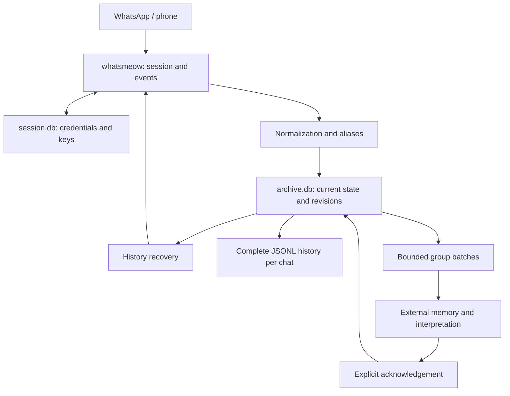
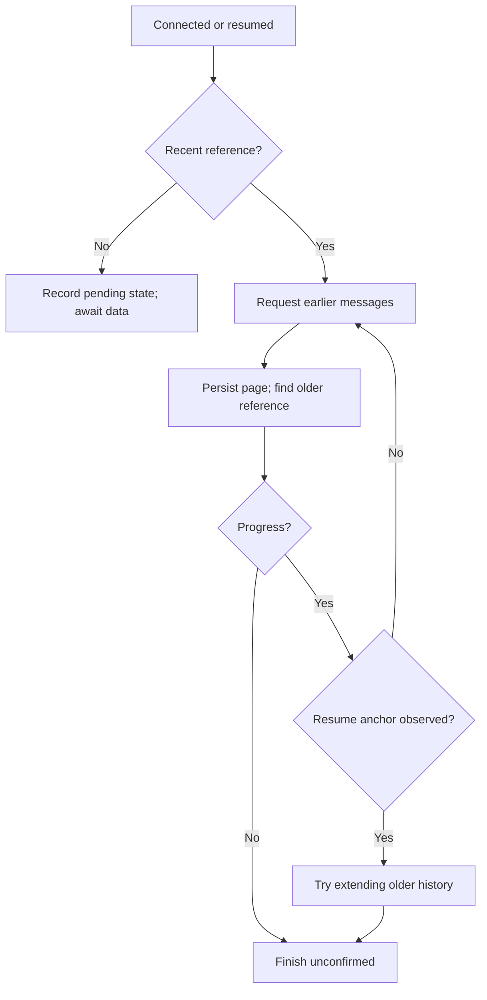

# How wpp works

This guide describes implemented behavior. See [Operation and commands](operation.md) for administration and [External consumption](ai-consumption.md) for downstream AI systems.

## 1. Application scope

wpp links a WhatsApp account as a connected device, receives selected groups/chats, stores normalized content in SQLite, exports JSONL events, and prepares bounded group batches for external consumers.

`run` captures in the foreground without HTTP. `serve` runs a local HTTP workspace and controls capture/history/transcription/export using the same `internal/service` coordinator. Another owner makes the panel consult-only. Other commands perform one action and exit. No system service is installed automatically.

Go, whatsmeow, and SQLite provide integration without a browser or the official WhatsApp API. AI interpretation, demand association, and semantic memory belong to the consuming system. English/Brazilian Portuguese presentation is independent of source content and recognition language.

## 2. Architecture

| Area | Responsibility | Code |
|---|---|---|
| CLI | Options, commands, signals | `cmd/wpp` |
| Integration | Login, connection, events, group queries, history requests | `internal/whatsapp` |
| Archive | Messages, aliases, recovery, revisions, JSONL, batches | `internal/archive` |
| Coordination | Operations, connection, history, audio, export, shutdown | `internal/service` |
| Transcription | Reservations, temporary media, local engine | `internal/transcription` |
| Panel | Protected local HTTP and view modules | `internal/webui` |
| Presentation | Explicit application languages and embedded messages | `internal/localization` |

Normalization yields a transport-independent model; storage/rendering need not interpret every protobuf structure directly.

## 3. Authentication and discovery

`login` opens the local session and displays a QR if unlinked. The holder scans it under **WhatsApp > Linked devices > Link a device**. After pairing it waits for connection and ten seconds of initial sync before discovering groups/contacts.

whatsmeow `sqlstore` persists credentials/keys in `session.db`; restarting usually reuses them. An existing-session login reports linkage without remotely proving that session remains valid. The archive binds to the first authenticated account; another account needs another data directory. Event handlers register before connecting.

`chats` queries joined groups and available contacts. Unnamed groups get individual detail queries with ten-second timeouts. History can supply names/display names; later empty names never erase known ones.

| Suffix | Meaning |
|---|---|
| `@g.us` | Group |
| `@s.whatsapp.net` | Phone-based user identity |
| `@lid` | Alternative user identity supplied by WhatsApp |

Names are mutable labels; tracking uses full IDs.

## 4. Selection and ingestion

`track` enables a chat persistently. `untrack` prevents new ingestion but preserves stored content. Untracked discovery/events retain metadata and one recent normalized envelope as a first-scan reference, not the complete chat history. Tracking ingests that reference if available. Valid undiscovered IDs can be tracked but remain unnamed/empty until delivery.

Live/history ingestion resolves proven aliases, unwraps ephemeral/caption/edit envelopes, normalizes identity/authorship/time/content/references, updates the recent reference, merges tracked messages and records changes, then commits before reporting persistence success. Protocol acknowledgements wait for handlers, reducing acknowledgement-before-write risk. They are neither contact read receipts nor a history completeness guarantee.

### Deduplication and ordering

Local keys include chat, message ID, direction, and sender for groups; direct-chat SQL keys do not additionally distinguish senders. Replays merge and create no revision when resulting state is unchanged. Late old messages are ingested; newest-known time is not a discard filter. LID/phone reconciliation is transactional and preserves source IDs and redirects when duplicates merge.

### Supported content

| Content | Representation |
|---|---|
| Text | Text and line breaks |
| Reply | Quoted ID/sender when available |
| Reaction | Emoji/removal marker and target reference; original text preserved |
| Image/video | Kind, caption, reply context |
| Audio | Kind, reference, later automatic transcript |
| Document | Kind, filename, caption, context |
| Sticker | Kind identification |
| Location | Available name/address/coordinates |
| Contact card | Available display name |
| Historical system event | Event-kind placeholder |
| Undecrypted content | Legacy `indisponível` placeholder |
| Unsupported kind | Kind placeholder without semantic interpretation |

Eligible audio is temporarily downloaded and removed after processing; other media are not downloaded. Unwrapping cannot recover undelivered/undecryptable content. Protocol controls unrelated to edits/deletions are not archived as chat text.

### Edits and deletions

Edits update current state; deletions set a marker. Mutations preceding originals can persist with unknown original time and reconcile later. Merge protects edits/deletions against old replays. Reactions keep independent keys and never edit the target message. Unique archived targets provide author/preview; unavailable encrypted reactions retain received references without invented content.

Previously unsupported placeholders can be enriched on recognized redelivery, producing recovery revisions. Opening the database transactionally repairs legacy reaction kinds while preserving source/revisions, without inventing lost emoji/target references. Those can return only on redelivery. Recovered content can replace unavailable placeholders. Earlier revisions and published batches remain: deleting on WhatsApp does not erase all historical local copies.

## 5. Recovery after interruption

`run` loads persisted checkpoints and marks interrupted attempts. After connection, it recovers tracked chats serially. Pending deliveries use normal ingestion; discovery remains an explicit panel/login/chat action.

History requests ask for up to 50 messages before a reference, with a 45-second timeout and correlation by request ID. Pages are separated by one second.

Without a reference newer than the checkpoint, requests cannot establish coverage of the offline period. The application can extend older history while retaining resume uncertainty. Attempts record start/end, anchor, detail, and overlap. States include `running` and `unconfirmed`. Observing an anchor resolves retry-to-anchor work without certifying completeness; unreached anchors remain for later attempts.

Retries occur every five minutes while connected. The first reference in a previously reference-free chat can trigger another attempt. Disconnection cancels the current scan; the library reconnects with increasing backoff. **Empty pages, silence, timeouts, and overlap never prove complete history or absence of gaps.**

## 6. JSONL-only export

`exports/chat-<hash>.jsonl` contains immutable observed events in local sequence, including distinct edits, deletions, transcriptions, and reactions—not just current state. Export uses a separate read-only WAL transaction, temporary file, sync, and rename. Generation marking follows publication; concurrent arrivals remain pending. File failure never undoes ingestion.

`events next|ack|status` supplies reserved JSONL batches with manifest/cursor/hash. `batch` aliases them. `evidence` publishes a group's source events. There is no Markdown renderer, text fragmentation, context generation, or demand memory. See [the contract](jsonl-events.md) and [consumer guide](ai-consumption.md).

## 7. Persistence

`session.db` belongs to whatsmeow: device, credentials, keys, connection state. `archive.db` belongs to wpp: archive and processing state. WAL, foreign keys, `FULL` synchronization, and a five-second busy timeout are used. Archive transactions use `BEGIN IMMEDIATE` and one connection per Store; preparation can briefly contend with capture.

| Table | Purpose |
|---|---|
| `meta` | Bound account and independent application language preference |
| `chats` | Names, tracking, recent reference, export paths/generations |
| `audio_jobs` | Private metadata, states, transcription reservations/phases |
| `people_names`, `group_people` | Canonical local registrations, observed group people/names |
| `aliases` | Alternative/canonical identities |
| `messages` | Current normalized state and stable source ID |
| `attempts` | Recovery attempts and anchors |
| `retired_exports` | Duplicate complete exports retired after reconciliation |
| `changes` | Sequence, source, revision, operation, change snapshot |
| `source_redirects` | Merged source redirects |
| `events` | Immutable versioned public event journal |
| `event_state`, `event_batches` | Group cursor/pending batch, reserved bytes/manifest/acknowledgement |
| `event_migration` | Revisions already imported into the event journal |
| `reaction_state` | Latest orderable individual reaction per actor/target |
| `analysis_state`, `analysis_batches` | Retained legacy Markdown state/reservations; unused by JSONL |
| `service_settings`, `service_operations` | Processing choices and operational tracking |

Change operations are `insert`, `update`, `edit`, `delete`, and `recover`, classified by resulting local state. An imported already-edited first revision can be `edit`; this is not a complete replay of original WhatsApp events. Sequence is global, so group-filtered sequences can have gaps. Revisions grow per source.

Schema 7 is controlled by `PRAGMA user_version`. Opening can create/migrate structures even for offline commands. Analysis migration transactionally adds stable sources/journal/cursors and baselines existing states ordered by `ts, id, sender, from_me, chat`. Errors abort migration; newer unsupported databases are rejected. Previously discarded revisions cannot be reconstructed. Old running binaries must restart to begin recording the new behavior. Presentation language requires no schema-version bump or event rewrite.

## 8. Concurrency and shutdown

Capture uses `data/wpp.lock`. Batch locks are `data/analysis-<hash-of-events:group>.lock`, shared by `events`/`batch`; evidence has its per-group lock. Kernel `flock` ownership matters, not the existence of a leftover lock file. Each group prepares/acknowledges serially; separate groups have separate locks but SQLite still serializes writes.

Ctrl+C/SIGTERM cancel requests/workers, wait for accepted callbacks, close connection, record interruptions, and try pending exports. Forced shutdown can leave stale JSONL or an incompletely published reserved batch; resume uses persisted state. Persistence failures stop capture. Export/history failures are tracked separately, allowing capture to continue with later export attempts or unconfirmed recovery.

## 9. Practical guarantees and limits

wpp provides transactional persistence, deduplication, local revisions, pending-batch redelivery, idempotent acknowledgement, and bounded consumer input. It does not guarantee full WhatsApp delivery, exactly-once agent execution, or semantic correctness.

This version has no third-party HTTP service, other-media download/transcription, automatic demand extraction/cross-group association, independent multiple consumers per group, manual export import, business-message sending, purge routine, or automatic expiration policy. Archives and batches grow; input limits do not bound total disk retention. Unofficial integration can require maintenance when the protocol changes.

## 10. Verification and integrated control

`make check` covers vet, race tests, and JavaScript, with temporary/fake data for merge, aliases, transactions, recovery, export, migrations, links, revisions, interrupted publication, and concurrent capture. Node.js is for development only; builds/running use Go/C. See [Architecture](architecture.md). Tests cannot establish real account history; use [operational validation](operation.md#validation-with-a-real-account).

`serve` adds name registration without changing identity or historical event names. Observed names stay in events; current registrations affect presentation without rewriting batches. See [the interface guide](interface.md).

A coordinated worker downloads temporary audio, runs FFmpeg/Whisper, and persists a new transcript revision without changing prior batches. See [Transcription](transcription.md). Processing choices and operation IDs/states/phases persist; abandoned operations become interrupted on resume without changing revisions/batches.

Connection/history/audio/export have separate coordination. Explicit sync fixes a finite source list after history, temporarily connecting if capture is paused. Each item has one attempt; failures/missing metadata remain pending. Current capture choice determines whether connection stays afterward. Transcription pause finishes current audio; capture pause cancels automatic recovery only. HTTP calls Go directly rather than shell/CLI; tasks belong to process context and survive request/tab closure. The inspector excludes private settings and credentials.
