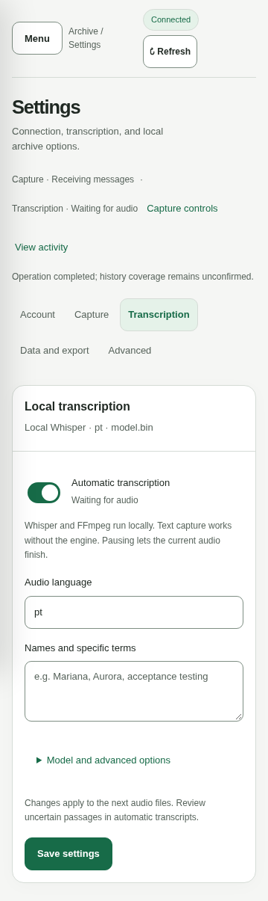

# Local web workspace

HTML, CSS, and JavaScript are embedded in the Go executable. `wpp serve` controls connection, capture, history, transcription, and export in the same process, without Node.js or a system service.

## Navigation and settings

Navigation keeps **Chats**, **Audio**, **People**, **Activity**, and **Settings** available. On compact screens, open **Menu**; Escape closes it and returns focus. On narrow screens, **Back to chats** returns from the reading pane to the list. Selection, searches, and reading position survive navigation. Local routes such as `#settings/transcription` support browser back/forward without starting or cancelling tasks.

| Settings category | Contents |
|---|---|
| Account | Account linking, reconnection, temporary QR |
| Capture | Continuous capture and local process explanation |
| Transcription | Automatic processing, audio language, vocabulary, technical options |
| Data and export | Complete exports, backup, startup options |
| Advanced | Application language and read-only database inspector |

The summary strip offers **Capture controls** and **View activity**. **Configure transcription** in Audio opens the appropriate settings. Onboarding follows actual account/tracking state and permits offline reading without an audio installation.

The panel follows the system light/dark theme, supports keyboard navigation and reduced motion, and returns focus when closing dialogs with Escape. Polling does not replace edited fields. Leaving an edited form offers **Continue editing** or **Discard changes**; saving is explicit and failures retain drafts. No settings are automatically saved in browser storage.



## Application language

A data directory without a language preference starts in English, regardless of browser or operating-system locale. Under **Settings > Advanced > Application language**, select **English** or **Português (Brasil)** and choose **Save language**. The choice is persisted in the archive's presentation metadata and shared with CLI commands using the same data directory.

Language selection also works in consultation mode and without an account or valid audio engine. It does not submit audio settings, start processing, change recognition language or time zone, or translate messages/transcripts/names. Switching preserves navigation, reading position, filters, focus, and unrelated drafts. Failed saves keep the previous effective language and retain the proposed selection for retry. Unsaved language selections use the same continue/discard navigation flow.

CLI equivalents are `wpp language`, `wpp language pt-BR`, and `wpp language en`. Global `--language en|pt-BR` overrides one invocation. When starting `serve`, it also supplies the initial panel language; an explicit panel save replaces that initial override for the browser session without implicitly persisting the override itself. Already-running CLI processes retain their invocation language. Dates follow the application language and existing configured time zone.

## Getting started

```bash
./wpp serve
# Open http://127.0.0.1:8080
./wpp --data-dir ./data --export-dir ./exports --listen 127.0.0.1:8090 serve
```

Global options precede the command. Initially **Continuous capture** is paused and **Automatic transcription** is enabled with Portuguese recognition and portable Whisper `large-v3-turbo` paths. Unavailable engine/model paths are explained in Settings without blocking text capture. Default installation paths are relative to the parent of `--data-dir`; use absolute paths for custom installations.

1. Open **Settings > Account > Connect WhatsApp**.
2. On your phone, open **WhatsApp > Linked devices > Link a device** and scan the QR. WhatsApp renews it; it disappears on expiry, cancellation, or completion.
3. Use **Refresh chats** to discover available groups, contacts, and names.
4. Select a chat and choose **Track**.
5. Use **Sync now** for a one-off operation or enable **Continuous capture**.

Closing the tab does not stop tasks. Ctrl+C stops the process, cancels operations/subprocesses, finishes accepted writes, and tries pending exports. Preferences persist: restarting `serve` resumes capture if it was enabled. Disable it before shutdown to restart paused.

## Chats and reading

The list opens in **Tracked**. **Available** contains only untracked chats. Each tab preserves its search and All types/Groups/Contacts filters across navigation and refresh. The full ID is in the chat header details. **Stop tracking** preserves messages, transcripts, evidence, and batches while preventing future ingestion and new audio reservations for that chat, including during capture.

Messages are newest first, 50 per page. Search text/transcripts and filter by sender. Authorship uses person-to-group routing. Replies show the quoted author and preview; opening the quote displays its original message without leaving the chat. Audio quotes use an available transcript. Edits/deletions are indicated, while absent or ambiguous references remain unavailable without invented authorship. Technical IDs live in details.

Visible pages poll every two seconds. The latest page can update when reading at the top; earlier reading is preserved and an explicit **New messages available · Show** action offers refresh. **Identify person** opens sender registration. **View record** shows normalized data and evidence ID. Text previews respect UTF-8 and a 12,000-byte limit, with a visible truncation notice; full content remains stored. Attachments show available metadata. Only eligible audio is temporarily downloaded.

## Capture, sync, and pause

**Continuous capture** connects and receives tracked chats. A scheduler requests history and retries periodically. Pausing stops automatic recovery, without cancelling an explicit sync. Undownloaded audio waits for resume or another sync.

**Sync now** requires a tracked chat but works with capture paused. It retrieves available history, then fixes a finite list of eligible audio for that chat. Each item gets one attempt during that operation; arrivals do not grow the list indefinitely. Missing metadata, failures, and outstanding items remain visible. With capture active, explicit sync takes priority after the current audio.

During a one-off connection, delivered messages from other tracked chats are also preserved. On completion or cancellation the connection remains only if the current capture choice requires it; changing the control during the operation is respected. Repeated sync requests reuse the existing operation. **Cancel** cancels that operation. Overlap, batch completion, and operational success never certify full history coverage.

## Audio and processing settings

Audio cards show chat, author, time, attempts, errors, and completed transcript previews. **View transcript** opens the full text with copy. Filters, focus, and open details survive updates. Real phases are download, conversion, recognition, and saving; percentages are not estimated.

**Retry** is available after the first failure and after permanent failures if download metadata exists. In an owning panel it processes only that audio, temporarily connecting if capture is paused, without fetching all history or enabling capture. It waits for the current worker and is cancellable. If transcription is paused, it requeues and asks you to enable processing and request again. An active background queue can process it after resume. Untracked chats must be tracked; missing metadata needs another sync. Completed/deleted/already-processing audio is not reprocessed. Consultation mode only requeues.

Pausing **Automatic transcription** prevents new reservations and lets current audio finish. Engine failure never stops text capture. Under **Settings > Transcription > Model and advanced options**, configure audio language, vocabulary, model, Whisper/FFmpeg, threads, and timeout. The controller validates before saving; rejected settings preserve persisted values and the editable draft. Vocabulary guides recognition, without summarizing requests. See [Transcription](transcription.md) for installation, limits, and retention.

**Activity** shows real phases, results, and cancellation. Interrupted operations are marked on restart; explicit syncs are not automatically restarted. New application diagnostics use stable translation identifiers. Legacy free-form operation details are retained as evidence, while the panel uses safe localized status summaries.

## Export

**Export JSONL** in a chat and **Settings > Data and export > Export all** rebuild complete event history from SQLite without connecting to WhatsApp. Files are `exports/chat-<hash>.jsonl`, using the incremental batches' contract. They never acknowledge batches or advance consumer cursors. **View record** offers `wpp evidence <group> <source>` for JSONL evidence. Legacy Markdown files are retained without regeneration.

## People and evidence

Open **People**, or **People in this chat**; choose a group, find a person by name/number/LID, choose **Edit name**, and save a recognizable name. Received and registered names have separate columns; registered names take precedence, and unnamed IDs remain visible.

**Register person** accepts a full `@s.whatsapp.net` or `@lid` ID not already in the list. It creates a local association, not a WhatsApp group member. Names allow up to 128 characters without controls; empty names remove existing registrations. Names apply across the account's groups. Proven WhatsApp LID/phone aliases reconcile registration; existing canonical registration wins conflicts. Unproven identities remain separate.

The list reflects observed messages, reply references, and received group metadata, not certified current membership. Names affect presentation, not historical events or published batch bytes. Identity uses native IDs and proven aliases, never names alone. wpp does not generate people directories or demand memory in Markdown.

## Inspector and protection

**Settings > Advanced > Database · Read only** browses allowed tables with pagination and bounded cell previews. It offers no arbitrary SQL or editing. Session data, private configuration, media descriptors, and tokens are excluded.

The server accepts loopback only, validates Host/port, requires an HttpOnly/SameSite Strict cookie and matching origin for mutations, and keeps QR codes out of logs and operations. Text enters the DOM without HTML interpretation; there are no external scripts. This is not authenticated remote access.

## Process conflicts and architecture

The owner holds `data/wpp.lock` even while paused. Another `run` or `serve` prevents concurrent ownership. A second panel permits reading, people registration, eligible requeue, and language preferences, but blocks connection, tracking, sync, processing settings, and exports. Stop the owner and restart the desired panel to take control. There is no external process termination, automatic takeover, or reason to delete lock files. Analysis uses separate per-group locks.

`internal/service` coordinates both `serve` and `run`. HTTP calls Go directly; tasks use process context and survive completed requests. History is serialized, the audio worker is single, and exports are coordinated. Schema 7 upgrades preserve session, messages, identities, sources, revisions, and batches. Stop old versions and back up before migration.

## Internal HTTP interfaces

All routes require the local cookie; mutations require matching origin. Async operations return 202 with an ID and expose progress through `GET /api/service`.

| Method | Route | Purpose |
|---|---|---|
| GET | `/api/service` | State, preferences, capabilities, operations |
| GET/PUT | `/api/preferences` | Persisted `application_language`; GET also returns `initial_language` |
| GET | `/api/translations` | Embedded public application message catalogs |
| POST | `/api/session/pair` | Pair or reconnect |
| GET | `/api/session/qr` | Private PNG; 404 when unavailable |
| POST | `/api/chats/discover` | Discover chats |
| PUT | `/api/chats/{id}/tracking` | `{"tracked":true}` |
| PUT | `/api/service/capture` | `{"enabled":true}` |
| PUT | `/api/service/transcription` | `{"enabled":true}` |
| POST | `/api/chats/{id}/sync` | History and finite audio list |
| POST | `/api/exports` | `{"chat_id":"…"}`; `{}` exports all |
| GET/PUT | `/api/service/settings` | Read/configure engine/model |
| POST | `/api/operations/{id}/cancel` | Cancel operation |
| GET | `/api/chats` | Chats and counts |
| GET | `/api/chats/{id}/messages` | `q`, `person`, `offset`, `limit` filters |
| GET/POST | `/api/groups/{id}/people` | Read/register names |
| GET | `/api/audio` | Chat/state filters and pagination |
| POST | `/api/audio/{source}/retry` | Owning controller: 202 operation; consultation: 200 requeue |
| GET | `/api/audio/{source}` | Public details and full transcript |
| GET | `/api/messages/{source}` | Original message by stable source |
| GET | `/api/tables`, `/api/tables/{name}` | Allowed inspector |
| GET | `/api/settings` | Display time zone |

Processing fields are `whisper_path`, `ffmpeg_path`, `model_path`, `language`, `vocabulary`, `threads`, and `timeout`. Capture/transcription fields in that form do not replace dedicated controls. Unknown fields are rejected; request bodies are limited to 16 KiB. Public errors retain safe `error` text and can add a stable `code`; operation details can add `detail_code` and safe parameters. Machine enum values and routes stay language independent.

## Validation

`make check` runs vet and race-detected tests on temporary databases. Coverage includes preferences, ownership conflicts, cancelled/expired QR, revoked sessions, finite sync, pause after current audio, invalid settings, text capture with engine failure, storage, batches, and HTTP protections. Browser tests use synthetic desktop/narrow data. Real history, pairing, and media availability require the account holder's phone; mocks do not guarantee account behavior.
