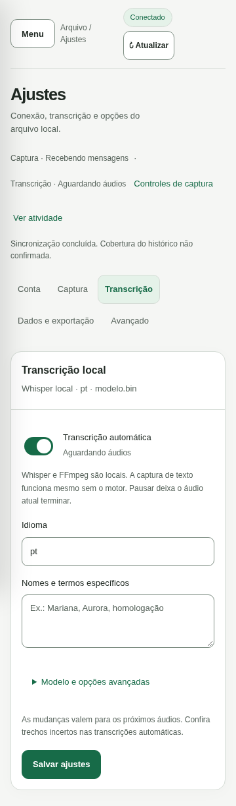

# Painel de controle local

HTML, CSS e JavaScript estão embutidos no executável Go. `wpp serve` controla conexão, captura, histórico, transcrição e exportação no mesmo processo, sem Node.js ou serviço do sistema.

## Navegação e ajustes

A navegação mantém **Conversas**, **Áudios**, **Pessoas** e **Atividade**, com **Ajustes** ao final. Em telas compactas, abra **Menu**; Escape fecha e devolve o foco. Em telas estreitas, lista e conversa aparecem separadas: **Voltar às conversas** retorna à lista. A seleção, buscas e posição de leitura permanecem durante a troca de áreas. Os atalhos usam fragmentos locais, como `#settings/transcription`; voltar/avançar do navegador funciona sem iniciar ou cancelar tarefas.

Ajustes tem cinco categorias, acessíveis pelo índice da própria página:

| Categoria | Conteúdo |
|---|---|
| Conta | Vínculo da conta, reconexão e QR temporário |
| Captura | Captura contínua e explicação do processo local |
| Transcrição | Controle automático, idioma, vocabulário e opções técnicas |
| Dados e exportação | Exportação completa, backup e opções de inicialização |
| Avançado | Inspetor do banco somente consulta |

O resumo acima do conteúdo mostra captura e transcrição e oferece **Controles de captura** e **Ver atividade**. Na fila de Áudios, **Configurar transcrição** abre a categoria correspondente. O próximo passo aparece conforme a conta e as conversas acompanhadas, sem impedir consulta offline ou exigir instalar áudio.

O painel acompanha o tema claro/escuro do sistema, aceita teclado e respeita movimento reduzido. Diálogos podem ser fechados com Escape, com retorno de foco. Campos editados não são substituídos pelo polling; sair de uma edição oferece **Continuar editando** ou **Descartar alterações**. Salvar é explícito e erros preservam o rascunho. Não há salvamento automático em armazenamento do navegador.



## Começar

```bash
./wpp serve
# Abra http://127.0.0.1:8080
```

Opções globais ficam antes do comando:

```bash
./wpp --data-dir ./dados --export-dir ./markdown --listen 127.0.0.1:8090 serve
```

Na primeira execução, **Captura contínua** começa pausada e **Transcrição automática** fica habilitada, com português e caminhos da instalação portátil do Whisper `large-v3-turbo`. Se modelo/executáveis estiverem indisponíveis, Ajustes explica o problema; mensagens continuam podendo ser capturadas. Caminhos padrão da instalação são relativos ao diretório pai de `--data-dir`; com diretórios personalizados, configure caminhos absolutos em Ajustes.

1. Em **Ajustes → Conta**, clique em **Conectar WhatsApp**.
2. No celular, abra **WhatsApp → Dispositivos conectados → Conectar dispositivo** e leia o QR. Ele é renovado conforme o WhatsApp e desaparece ao expirar, cancelar ou concluir.
3. Use **Atualizar conversas** para descobrir grupos, contatos e nomes disponíveis.
4. Selecione uma conversa e clique em **Acompanhar**.
5. Use **Sincronizar agora** para uma execução pontual ou habilite **Captura contínua**.

Fechar a aba não interrompe tarefas. Ctrl+C no terminal encerra o processo, cancela operações e subprocessos, conclui gravações aceitas e tenta exportar alterações pendentes. As escolhas ficam salvas no SQLite: reiniciar `serve` retoma a captura se estava habilitada. Para reiniciar pausado, desative o controle antes de encerrar.

## Conversas e leitura

A lista abre na aba **Acompanhadas**. **Disponíveis** reúne apenas conversas ainda não acompanhadas, para consultar e adicionar. Cada aba preserva sua busca e filtro Todos os tipos, Grupos ou Contatos durante a navegação e atualização. O ID completo fica no detalhe do cabeçalho. **Parar acompanhamento** preserva mensagens, transcrições, evidências e lotes; impede ingestão futura daquela conversa e novas reservas de áudio. Funciona durante a captura.

Mensagens aparecem das mais recentes para as mais antigas, em páginas de 50. Busque texto/transcrições e filtre pelo remetente. Autoria é exibida como **pessoa → grupo**; respostas mostram um bloco com autor e conteúdo da mensagem citada. Clique no bloco para abrir a mensagem original sem sair da conversa. Citações de áudio usam a transcrição disponível; edições e exclusões são sinalizadas. Referências ausentes ou ambíguas aparecem como indisponíveis, sem autoria inventada. IDs técnicos ficam no detalhe.

A página consulta estados a cada dois segundos enquanto visível. Seleção, filtros e leitura anterior são preservados. A primeira página pode atualizar quando está no topo; ao consultar conteúdo anterior, um aviso permite atualizar explicitamente.

**Identificar pessoa** abre o cadastro do remetente. **Ver registro** mostra registro normalizado e ID da evidência. A prévia textual tem limite de 12.000 bytes, respeitando UTF-8 e sinalizando o limite; o conteúdo integral permanece no banco. Anexos mostram metadados disponíveis. Apenas áudios elegíveis são baixados temporariamente pelo worker.

## Captura, sincronização e pausas

**Captura contínua** conecta e recebe mensagens das conversas acompanhadas. O agendador solicita histórico e tenta novamente periodicamente. Pausar interrompe a recuperação automática; não cancela sincronização pontual. Áudios ainda não baixados aguardam retomada ou nova sincronização.

**Sincronizar agora** exige conversa acompanhada e funciona com captura pausada. Busca o histórico disponível e então fixa uma lista de áudios elegíveis daquela conversa. Cada item tem uma tentativa nessa execução. A lista não cresce indefinidamente com novas mensagens; falhas, ausência de metadados e pendências são sinalizadas. Com captura ativa, tem prioridade depois do áudio atual.

Durante uma conexão pontual, mensagens entregues de outras conversas acompanhadas também são preservadas. Ao terminar ou cancelar, a conexão permanece somente se a escolha atual de captura pedir isso. Alterar o controle durante a operação é respeitado.

Cliques repetidos numa sincronização solicitada devolvem a mesma operação. **Cancelar** interrompe aquela execução. Histórico integral nunca é confirmado por sobreposição, término de lote ou sucesso operacional; a cobertura continua não confirmada.

## Áudios e ajustes

**Áudios** apresenta cartões com conversa, autor, data, tentativas e erros. Transcrições concluídas têm prévia no cartão e **Ver transcrição** abre o texto integral com opção de copiar. A tela preserva filtros, foco e o detalhe aberto durante atualizações. É possível filtrar por conversa e estado e consultar etapas reais: download, conversão, reconhecimento e gravação. Não há porcentagem estimada. **Tentar novamente** está disponível após o primeiro erro e também nas falhas definitivas, quando há descritor disponível. Processa somente o áudio escolhido, com conexão temporária se a captura estiver pausada, sem buscar todo o histórico ou ativar captura contínua. A tentativa aguarda o worker atual e pode ser cancelada pela operação. A pausa global da transcrição é respeitada: nesse caso, reenfileira e orienta a ativar o controle e solicitar novamente o áudio. Com captura contínua ativa, a fila também pode processá-lo automaticamente após a retomada. Conversas desativadas precisam ser acompanhadas antes do processamento. Metadados ausentes exigem nova sincronização; áudios concluídos/excluídos ou já em processamento não são reprocessados.

Pausar **Transcrição automática** impede novas reservas e deixa o áudio atual terminar. Falhas do motor não interrompem captura de textos.

Em **Ajustes → Transcrição → Modelo e opções avançadas**, configure idioma, vocabulário, modelo, Whisper, FFmpeg, threads e timeout. O controlador valida motor/modelo antes de salvar. Configurações inválidas preservam as anteriores; mudanças valem para próximos áudios. O vocabulário orienta reconhecimento, sem resumir demandas. Consulte [Transcrição](transcricao.md) para instalação, limites e retenção.

A área **Atividade** mostra etapa, resultado e cancelamento das operações. Operações interrompidas por encerramento forçado aparecem como interrompidas na próxima inicialização; sincronizações pontuais não reiniciam automaticamente.

## Exportação

**Exportar JSONL** na conversa e **Exportar todas** em Ajustes → Dados e exportação reconstroem o histórico completo de eventos a partir do SQLite, sem conectar ao WhatsApp. Os arquivos são `exports/chat-<hash>.jsonl` e usam o mesmo contrato dos lotes incrementais.

Essas ações não confirmam lotes nem avançam o cursor do consumidor. **Ver registro** fornece `wpp evidence <grupo> <fonte>`, que agora exporta JSONL. Arquivos Markdown antigos são mantidos como legado, sem regeneração.

## Pessoas

1. Abra **Pessoas** ou **Cadastrar pessoas** na conversa.
2. Escolha o grupo.
3. Localize a pessoa pelo nome, número ou LID e clique em **Editar nome**.
4. Informe um nome reconhecível e salve.

Há colunas separadas para o nome recebido e o nome cadastrado. O cadastro tem precedência sobre o nome recebido. IDs sem um nome disponível continuam visíveis.

Para alguém ainda ausente da lista, use **Cadastrar pessoa**, informando o ID completo `@s.whatsapp.net` ou `@lid`. Esse cadastro adiciona uma associação local; não adiciona participantes ao WhatsApp. Nomes admitem até 128 caracteres, sem caracteres de controle. Salvar um nome vazio remove um cadastro existente.

O nome vale para a identidade em todos os grupos da conta. Quando o WhatsApp informa que um LID corresponde a um número, o cadastro é reconciliado com esse número. Em conflito, prevalece o nome já cadastrado na identidade canônica. Identidades sem uma associação comprovada permanecem separadas.

A lista reúne pessoas observadas nas mensagens, referências de respostas e metadados recebidos do grupo. Ela não comprova a composição atual do grupo.


## Nomes e evidências

Nomes cadastrados afetam a apresentação no painel, não o conteúdo histórico dos eventos ou os bytes de lotes publicados. A identidade continua baseada em IDs nativos e aliases comprovados, nunca apenas em nomes. O wpp não gera diretório de pessoas nem memória de demandas em Markdown.

## Inspetor e proteção

**Ajustes → Avançado → Banco de dados · Somente consulta** navega nas tabelas permitidas, com paginação e prévias limitadas de células. Não aceita SQL livre nem edição de registros. `session.db`, configurações privadas, descritores de mídia e tokens ficam fora do inspetor.

O servidor aceita somente loopback, valida Host/porta, exige cookie HttpOnly/SameSite Strict e origem correspondente em todas as mutações. QR exige cookie e não fica em logs ou operações. Textos entram no DOM sem interpretação de HTML; não há scripts externos. A interface não oferece acesso remoto autenticado.

## Conflito entre processos

O controlador adquire `data/wpp.lock` mesmo pausado. Outro `run` ou `serve` no diretório impede execução concorrente. O segundo painel permite consulta, cadastro de pessoas e retry, mas bloqueia conexão, acompanhamento, sincronização, ajustes de execução e exportação.

Encerre o processo responsável e reinicie o painel desejado para assumir controle. Não há encerramento de processos externos ou tomada automática do lock. Não apague arquivos de lock. Análise usa locks próprios por grupo.

## Arquitetura e migração

`internal/service` coordena o controlador compartilhado por `serve` e `run`. HTTP chama métodos Go diretamente; tarefas usam contexto do processo e continuam após a requisição terminar. Histórico é serializado, worker de áudio é único e exportações são coordenadas.

A abertura migra transacionalmente para o esquema **7**, incluindo o diário de eventos, os lotes JSONL e os nomes de exportação `.jsonl`. Sessão, mensagens, identidades, fontes, revisões e lotes são preservados. Encerre versões antigas e faça backup antes de migrar.

## Interfaces HTTP internas

Exigem cookie local; mutações exigem origem correspondente. Operações assíncronas retornam HTTP 202 com ID. Resultado/progresso ficam em `GET /api/service`.

| Método | Caminho | Função |
|---|---|---|
| GET | `/api/service` | Estado, escolhas, capacidades e operações |
| POST | `/api/session/pair` | Parear ou reconectar |
| GET | `/api/session/qr` | PNG privado, 404 se indisponível |
| POST | `/api/chats/discover` | Descobrir conversas |
| PUT | `/api/chats/{id}/tracking` | JSON `{"tracked":true}` |
| PUT | `/api/service/capture` | JSON `{"enabled":true}` |
| PUT | `/api/service/transcription` | JSON `{"enabled":true}` |
| POST | `/api/chats/{id}/sync` | Histórico e lista finita de áudios |
| POST | `/api/exports` | JSON `{"chat_id":"…"}`; `{}` exporta todas |
| GET/PUT | `/api/service/settings` | Consultar/configurar motor/modelo |
| POST | `/api/operations/{id}/cancel` | Cancelar operação |
| GET | `/api/chats` | Conversas e contagens |
| GET | `/api/chats/{id}/messages` | Filtros `q`, `person`, `offset`, `limit` |
| GET/POST | `/api/groups/{id}/people` | Consultar/cadastrar nomes |
| GET | `/api/audio` | Filtros `chat`, `state` e paginação |
| POST | `/api/audio/{source}/retry` | Operação 202 no controlador proprietário; reenfileiramento 200 no painel em consulta |
| GET | `/api/audio/{source}` | Detalhe público e transcrição integral |
| GET | `/api/messages/{source}` | Mensagem original por fonte estável |
| GET | `/api/tables` e `/api/tables/{nome}` | Inspetor permitido |
| GET | `/api/settings` | Fuso de apresentação |

Ajustes usam `whisper_path`, `ffmpeg_path`, `model_path`, `language`, `vocabulary`, `threads` e `timeout`. Campos de captura/transcrição enviados ali não substituem controles dedicados. Campos desconhecidos são rejeitados; corpo limitado a 16 KiB.

## Validação

`make check` executa vet e testes com detector de corrida usando bancos temporários. Cobre preferências, conflitos, QR cancelado/expirado, sessão revogada, sincronização finita, pausa após áudio atual, ajustes inválidos e captura diante de falha do motor, além de armazenamento, lotes e proteção HTTP.

A interface é validada com dados fictícios em desktop e tela estreita. Disponibilidade real de histórico, pareamento e mídia precisa ser conferida pelo titular com o celular; testes simulados não garantem comportamento da conta.
